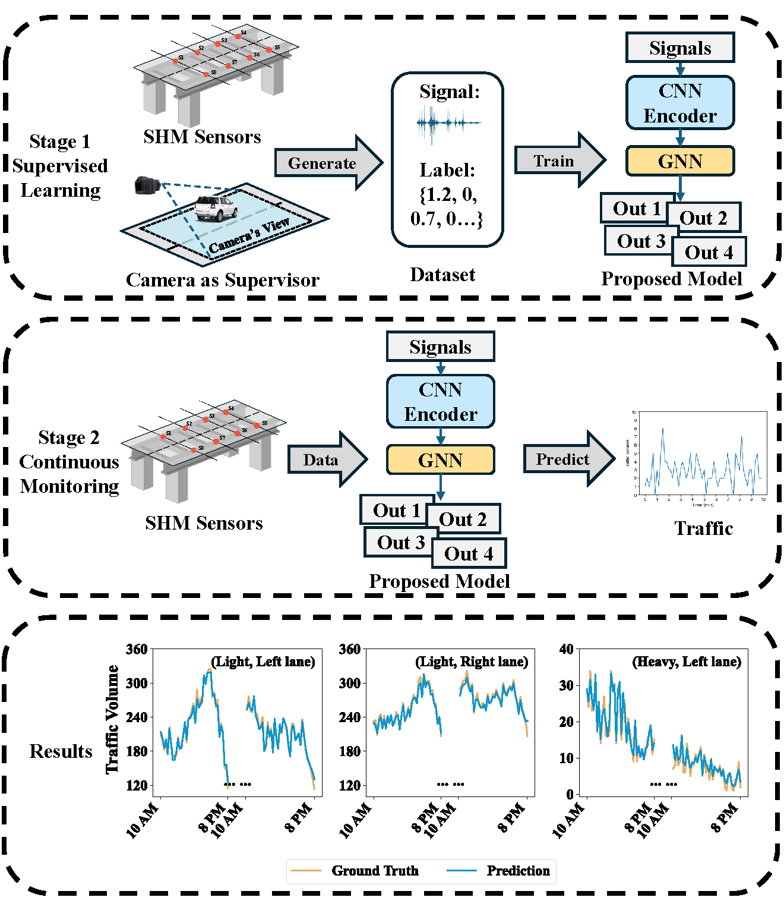

# SHMSN-Traffic-Monitoring

[](https://www.sciencedirect.com/science/article/pii/S0263224126030745)
[](LICENSE)

This repository contains the implementation of the paper:

> Wu, H., Jian, X., Lataniotis, C., Hoelzl, C., Chatzi, E., & Reuland, Y. (2026). Automating traffic monitoring with SHM sensor networks via vision-supervised deep learning. *Measurement*, 292, 123364. [https://www.sciencedirect.com/science/article/pii/S0263224126030745](https://www.sciencedirect.com/science/article/pii/S0263224126030745)



*The proposed pipeline (Fig. 6 of the paper, CC BY 4.0).*

## 📣 News

[2026.10.13] Our paper is published in *Measurement* (open access).

[2025.07.03] The preprint of our paper is available.

## 🔍 Overview

A structural health monitoring (SHM) sensor network on a bridge (8 accelerometers, 8 strain
gauges) is trained to count vehicles per lane and class (light / heavy), using labels produced
automatically by a computer-vision pipeline (YOLO11 detection + OC-SORT tracking on a camera).
Each 5 s window of the sensor network is encoded by a YOLO11-style CNN per sensor, the sensors
exchange information through graph attention (GATv2) over a ladder-shaped sensor graph, and
the graph embedding is regressed to four fractional counts:
`[LeftCar, RightCar, LeftTruck, RightTruck]` (left = overtaking lane, right = slow lane).

This repository contains the SHM side of the pipeline: dataset generation from CV labels,
the proposed CNN + GNN models, the baselines of the paper and the evaluation code.

## 📁 Repository structure

```
├── train/
│   ├── single.py              CNN + GNN on one modality (acc or strain)   -> ModelRegGNN
│   ├── dual.py                CNN + GNN on accelerations + strains        -> DualRegGNN
│   ├── cnn.py                 CNN baseline                                -> CNN
│   └── fegnn.py, femlp.py     feature-engineering + GNN / MLP baselines   -> FEGNN / FEMLP
├── evaluation/
│   ├── precision.py           FP32 / FP16 / INT8 evaluation of trained checkpoints
│   └── speed_test.py          inference-time benchmark (incl. peak-detection baseline)
├── tools/
│   ├── generator.py           raw recordings + CV labels -> labelled training windows
│   └── feat_write.py          training windows -> hand-crafted features
├── utils/                     models, encoder blocks, graph construction, datasets, metrics
├── notebooks/
│   ├── DatasetGenerator.ipynb CV labels -> label table; hourly test recordings; data exploration
│   ├── Evaluation.ipynb       hourly MAE / accuracy of trained runs
│   ├── PeakDetector.ipynb     peak-detection baseline
│   └── plot.ipynb             figures of the paper (written to figures/)
├── scripts/train_all.sh       all training runs of the paper (plain bash or SLURM)
└── images/                    images of this README
```

## ⚙️ Installation

The paper used PyTorch 2.3.1 with CUDA 12.1 and DGL 2.4.0. Install PyTorch and DGL for your
platform first (see [pytorch.org](https://pytorch.org/get-started/previous-versions/) and
[dgl.ai](https://www.dgl.ai/pages/start.html)), e.g. for CUDA 12.1:

```bash
pip install torch==2.3.1 --index-url https://download.pytorch.org/whl/cu121
pip install dgl==2.4.0 -f https://data.dgl.ai/wheels/torch-2.3/cu121/repo.html
pip install -r requirements.txt
```

All scripts are run as modules from the repository root (`python -m train.single ...`); the
notebooks switch to the repository root in their first cell.

## 📊 Data

The monitoring data belong to the Swiss Federal Roads Office (FedRO) and are **not public**,
so the scripts cannot be run end-to-end without access to them. To apply the code to your own
sensor network, provide data in the following format (pickled Python dicts, `numpy` arrays):

| folder | one file per | content |
|---|---|---|
| `data/train/` | 5 s training window | `{"signal": (2, 500, 8), "label": [LeftCar, RightCar, LeftTruck, RightTruck]}` |
| `data/train_feat/` | training window | `{"feat": (2, 8, 8), "label": [...]}`, produced by `tools/feat_write.py` |
| `data/test/` | hour of recording | `{"signal": (2, T, 8), "label": (T // 500, 4)}`, T a multiple of 500 |

Axis 0 of `signal` is the modality (0 = acceleration, 1 = strain), the last axis the 8 sensor
nodes, ordered along one girder and back along the other (see `create_ladder` in
`utils/engine.py`). Signals are sampled at 100 Hz and pre-processed as in `utils/composer.py`.
Labels are fractional counts: a vehicle only partly inside a window counts with the fraction of
its passage that falls into it.

The training windows of the paper (first five days, 2.5 s stride, 69,849 windows) were built with

```bash
python -m tools.generator --raw <raw recordings> --labels data/label_axle_corr.csv --out data/train
```

where the label table is derived from the CV trajectories in `notebooks/DatasetGenerator.ipynb`, which
also builds the hourly test recordings of the last two days (non-overlapping windows).

## 🚀 Training and evaluation

```bash
python -m train.single --channel acc       # CNN + GNN, accelerations
python -m train.single --channel strain    # CNN + GNN, strains
python -m train.dual                       # CNN + GNN, accelerations + strains
python -m train.cnn --channel strain       # baselines
python -m tools.feat_write && python -m train.fegnn --channel strain && python -m train.femlp --channel strain
```

or `bash scripts/train_all.sh` for all runs. Every script trains with an 80/20 random
train/validation split (AdamW, lr 0.005, cosine annealing with warm restarts, batch size 256,
Gaussian-noise augmentation with std 0.04 for the raw-signal models, early stopping on the
validation loss), keeps `best.pth`, and then evaluates it on `data/test/` in FP32, FP16 and
INT8. The logs report the hourly MAE, relative MAE and accuracy (`utils/metrics.py`). Results
are written to `runs/<Model>_Reg_Train/train<N>/`. `--data`, `--testset`, `--noise` and
`--seed` can be set on the command line.

To re-evaluate trained checkpoints only, or to benchmark the inference time:

```bash
python -m evaluation.precision --acc_dir <run> --strain_dir <run> --dual_dir <run> --testset data/test
python -m evaluation.speed_test --device cpu
```

## 📈 Results

Hourly traffic prediction on 20 h of daytime test data (Tables 4 and 5 of the paper).
Accuracy = sum(min(pred, gt)) / sum(max(pred, gt)) over the hourly volumes.

**Right (slow) lane**

| Inputs | Light MAE | Light MAE% | Light acc. | Heavy MAE | Heavy MAE% | Heavy acc. |
|---|---|---|---|---|---|---|
| Peak detection (baseline) | 139.55 | 13.15 % | 87.13 % | 24.75 | 46.61 % | 67.94 % |
| Acceleration & strain | 9.69 | 0.91 % | 99.09 % | 2.81 | 5.29 % | 94.83 % |
| Acceleration | 15.23 | 1.43 % | 98.58 % | 3.51 | 6.61 % | 93.59 % |
| Strain | 14.18 | 1.34 % | 98.67 % | 2.92 | 5.50 % | 94.63 % |

**Left (overtaking) lane**

| Inputs | Light MAE | Light MAE% | Light acc. | Heavy MAE | Heavy MAE% | Heavy acc. |
|---|---|---|---|---|---|---|
| Peak detection (baseline) | 106 | 12.08 % | 88.67 % | 0.55 | 84.62 % | 35.29 % |
| Acceleration & strain | 18.01 | 2.05 % | 97.98 % | 0.62 | 91.78 % | 36.74 % |
| Acceleration | 33.07 | 3.77 % | 96.30 % | 0.59 | 86.51 % | 27.99 % |
| Strain | 10.04 | 1.14 % | 98.87 % | 2.17 | 318.87 % | 23.87 % |

Heavy vehicles in the overtaking lane occur in only about 1 per mille of the samples, which is
too rare for effective learning (see the paper).

Trained weights are not distributed, as they are derived from the non-public monitoring data.

## 📜 License

This project is released under the [GNU Affero General Public License v3.0](LICENSE)
(`AGPL-3.0-only`).

Third-party code:

- `utils/modules.py` is adapted from [Ultralytics YOLO](https://github.com/ultralytics/ultralytics)
  (AGPL-3.0); the modifications are listed in the file header.
- The learning-rate scheduler is
  [pytorch-cosine-annealing-with-warmup](https://github.com/katsura-jp/pytorch-cosine-annealing-with-warmup) (MIT),
  installed as a dependency.

## 📝 Citation

```bibtex
@article{wu2026automating,
  title   = {Automating traffic monitoring with SHM sensor networks via vision-supervised deep learning},
  author  = {Wu, Hanshuo and Jian, Xudong and Lataniotis, Christos and Hoelzl, Cyprien and Chatzi, Eleni and Reuland, Yves},
  journal = {Measurement},
  volume  = {292},
  pages   = {123364},
  year    = {2026},
  doi     = {10.1016/j.measurement.2026.123364}
}
```

## 🙏 Acknowledgments

We gratefully acknowledge the Maintenance Planning Division of the Federal Roads Office (FedRO),
Switzerland, for granting permission to use the monitoring data in this publication.

## 📧 Contact

Please contact hanswu@student.ethz.ch should you have any questions.
